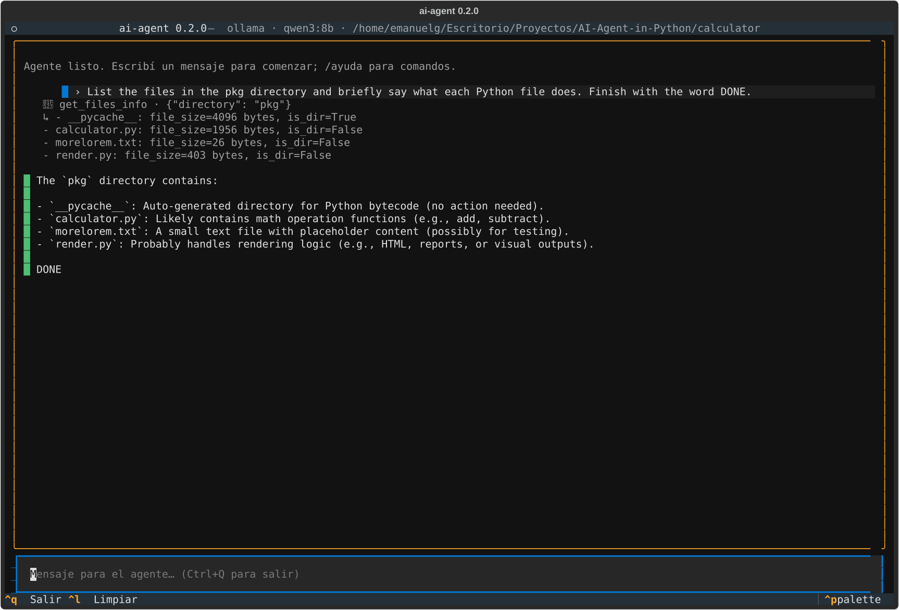
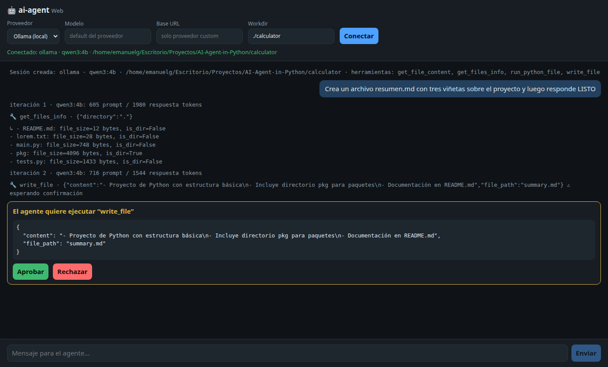

# AI Agent in Python

[](https://www.python.org/)
[](https://docs.astral.sh/uv/)
[](./LICENSE)

Agente de IA con herramientas reales sobre el sistema de archivos: explora proyectos,
lee código, escribe archivos y ejecuta Python — siempre dentro de un sandbox que elegís
vos, y pidiéndote aprobación antes de cualquier acción destructiva.

Funciona con **cualquier proveedor compatible con la API de OpenAI**: OpenRouter, Ollama
(modelos locales, sin costo ni conexión a internet), OpenAI, Groq, LM Studio… cambiar de
cerebro es un flag, no un refactor. Cuatro formas de usarlo: CLI de un tiro, REPL
conversacional, TUI con streaming en vivo e interfaz Web.



## Por qué este proyecto es distinto de un wrapper de la API

| | |
| --- | --- |
| **Sin proveedor fijo** | Núcleo desacoplado del SDK: un solo adaptador cubre todos los LLMs compatibles; el agente no sabe contra qué habla. |
| **Human-in-the-loop** | `write_file` y `run_python_file` se pausan hasta que aprobás (tecla o botón). Si rechazás, el modelo recibe la denegación y continúa sin reintentar a ciegas. |
| **Sandbox real** | Rutas validadas con `realpath` + `commonpath` contra traversal y symlinks; timeouts y límites de tokens de contexto configurables. |
| **Un núcleo, cuatro UIs** | El agente emite eventos tipados; cada interfaz es una capa fina de render. La lógica se prueba una sola vez. |
| **Tolerancia al mundo real** | Los modelos locales generan JSON roto: el agente devuelve el error al modelo como resultado de herramienta y deja que se autocorrija. |
| **Testeable sin red** | 135 tests (núcleo, herramientas, API, TUI) corren con proveedores falsos: `uv run pytest` no necesita claves ni internet. |

## Inicio rápido

```bash
uv sync                      # instala entorno y dependencias
cp .env.example .env         # plantilla comentada con todas las variables

# Con Ollama (local, gratis):
ollama pull qwen3:4b
uv run ai-agent --provider ollama "Lista los archivos y explica qué hace cada uno"

# Con OpenRouter: completá OPENROUTER_API_KEY en el .env
uv run ai-agent "¿Qué framework usa este proyecto?"
```

Por defecto el agente trabaja sobre `./calculator/` (un proyecto de ejemplo incluido).
Para usarlo con tu código: `--workdir ~/proyecto`.

## Las cuatro interfaces

```bash
uv run ai-agent "prompt"     # un tiro (scripting)
uv run ai-agent              # REPL multi-turno con sesiones
uv run ai-agent --tui        # terminal enriquecida con streaming token a token
uv run ai-agent --web        # navegador en http://127.0.0.1:8000
```

| Interfaz | Confirmaciones | Particular |
| --- | --- | --- |
| CLI un tiro | `[s/N]` en terminal | Ideal para automatizar tareas puntuales. |
| REPL | `[s/N]` en terminal | Contexto entre turnos; `/modelo`, `/proveedor`, `/directorio` en caliente; `/guardar` y `/cargar` sesiones en JSON. |
| TUI | Modal con teclas `s`/`n` | Chat con ventanas, actividad de herramientas en vivo, CSS propio. |
| Web | Botones Aprobar/Rechazar | Backend FastAPI que streammea los eventos del agente por SSE dentro del propio POST del turno. |



> Capturas adicionales en [`assets/`](./assets): [turno completado](./assets/web-aprobada.png) y [TUI](./assets/tui-ollama.svg).

## Cómo funciona

El corazón es el bucle de *tool calling*: el LLM no ejecuta nada, **solicita** acciones
como JSON estructurado, y el código las valida y ejecuta.

```
┌────────────┐  mensajes + esquemas de tools  ┌──────────────┐
│            │ ──────────────────────────────▶│              │
│    Agent   │                                │  LLMProvider │
│ (bucle +   │◀──── texto final | tool_calls ─│   (cualquiera│
│  historial)│                                │  compatible) │
└─────┬──────┘                                └──────────────┘
      │ tool_calls aprobados por el usuario (HITL)
      ▼
┌──────────────┐   rutas dentro del sandbox   ┌─────────────────────┐
│ ToolRegistry │ ────────────────────────────▶│ archivos · python   │
└──────────────┘                              └─────────────────────┘
```

1. Se envía la conversación junto con el esquema JSON de cada herramienta; el **modelo
   elige** cuál usar según las descripciones (por eso cada descripción está escrita
   como si fuera la única pista que tiene el agente).
2. Si devuelve `tool_calls`, el `ToolRegistry` inyecta el contexto de seguridad
   (directorio, límites — el modelo no puede definirlos), muestra un pedido de
   aprobación si la herramienta es destructiva, y ejecuta fuera del event loop.
3. El resultado vuelve al historial como mensaje `tool` y el ciclo se repite hasta la
   respuesta final, con tope de iteraciones.
4. Todo el recorrido se notifica como **eventos tipados**; las interfaces solo renderizan.

## Herramientas disponibles

| Herramienta | Qué hace | Confirmación |
| --- | --- | --- |
| `get_files_info` | Lista archivos con tamaño y tipo (un `ls -l` del sandbox). | — |
| `get_file_content` | Lee un archivo, truncado a `max_file_chars` para cuidar el contexto. | — |
| `write_file` | Crea/sobrescribe archivos, generando carpetas padre. | **sí** |
| `run_python_file` | Ejecuta `.py` del sandbox con args, timeout de 30 s y salida capturada. | **sí** |

Agregar una herramienta nueva = una función + una declaración `Tool` + un test: el
registro genera los esquemas y el despacho sin listas manuales.

## Proveedores

| Perfil | Base URL | Modelo default | Clave |
| --- | --- | --- | --- |
| `openrouter` (default) | openrouter.ai/api/v1 | `openrouter/free` | `OPENROUTER_API_KEY` |
| `ollama` | `http://localhost:11434/v1` | `qwen3:8b` | ninguna (local) |
| `openai` | api.openai.com/v1 | `gpt-4o-mini` | `OPENAI_API_KEY` |
| `custom` | la que indiques | la que indiques | si la requiere |

Resolución: flags de CLI > `.env`/entorno (prefijo `AGENT_`) > preset > default. La clave
busca `AGENT_API_KEY` y luego la variable histórica del proveedor, así configs viejas
siguen funcionando.

## Configuración (todas opcionales)

| Variable | Default | Para qué |
| --- | --- | --- |
| `AGENT_PROVIDER` | `openrouter` | Perfil activo. |
| `AGENT_MODEL` / `AGENT_BASE_URL` | del preset | Modelo y endpoint. |
| `AGENT_WORKDIR` | `./calculator` | Sandbox del agente. |
| `AGENT_MAX_ITERATIONS` | `20` | Vueltas máximas del bucle por turno. |
| `AGENT_MAX_FILE_CHARS` | `10000` | Corte de `get_file_content`. |
| `AGENT_TEMPERATURE` | `0` | Determinismo del tool calling. |
| `AGENT_REQUEST_TIMEOUT` | `120` | Timeout HTTP al proveedor. |
| `AGENT_VERBOSE` | `false` | Tokens y detalles de herramientas por defecto. |

## Tests

```bash
uv run pytest        # 135 tests, ~6 s, sin red ni claves
```

Bucle del agente con proveedor falsificado y respuestas guionizadas (confirmaciones
aprobadas/rechazadas, JSON inválido, límite de iteraciones), herramientas con rutas
reales en `tmp_path` (traversal, symlinks, timeouts), API Web sobre uvicorn real en
puerto efímero, TUI con el pilot de textual.

## Estructura

```
src/ai_agent/
├── agent.py            # bucle de tool calling async (el corazón)
├── events.py           # contrato entre núcleo e interfaces
├── config.py           # Settings + presets de proveedor
├── sessions.py         # sesiones JSON persistidas
├── providers/          # Protocol LLMProvider + adaptador OpenAI-compatible
├── tools/              # registry + herramientas de archivos y ejecución
├── prompts.py          # instrucciones del sistema
├── cli.py              # un tiro + REPL
├── tui/                # textual: chat, worker, diálogo modal
└── web/                # FastAPI: SSE por turno + frontend vanilla
tests/                  # pytest sin dependencias externas
calculator/             # proyecto demo para pruebas del agente
```

## Seguridad

El sandbox restringe rutas y la confirmación humana protege lo destructivo, pero es una
frontera **lógica**: el código que aprobás corre con tus permisos. Usalo con proyectos de
confianza y recordá que todo lo que hay dentro del `workdir` (incluidos `.env` de otros
proyectos) es legible por el agente. Aislamiento por contenedores: ver roadmap.

## Roadmap

- Docker como sandbox de nivel sistema operativo.
- Render de Markdown en la TUI y modo multi-sesión en la Web.
- Nuevas herramientas (búsqueda de patrones, diffs con aprobación).
- Empaquetado y publicación en PyPI.

## Estado

Versión 0.2.0 — núcleo refactorizado, multi-proveedor, confirmaciones HITL y cuatro
interfaces operativas. Probado contra OpenRouter (tier gratuito) y Ollama
(`qwen3:8b` / `qwen3:4b`) en Linux.

## Licencia

[MIT](./LICENSE) — podés usar, modificar y distribuir el proyecto citando la autoría.
